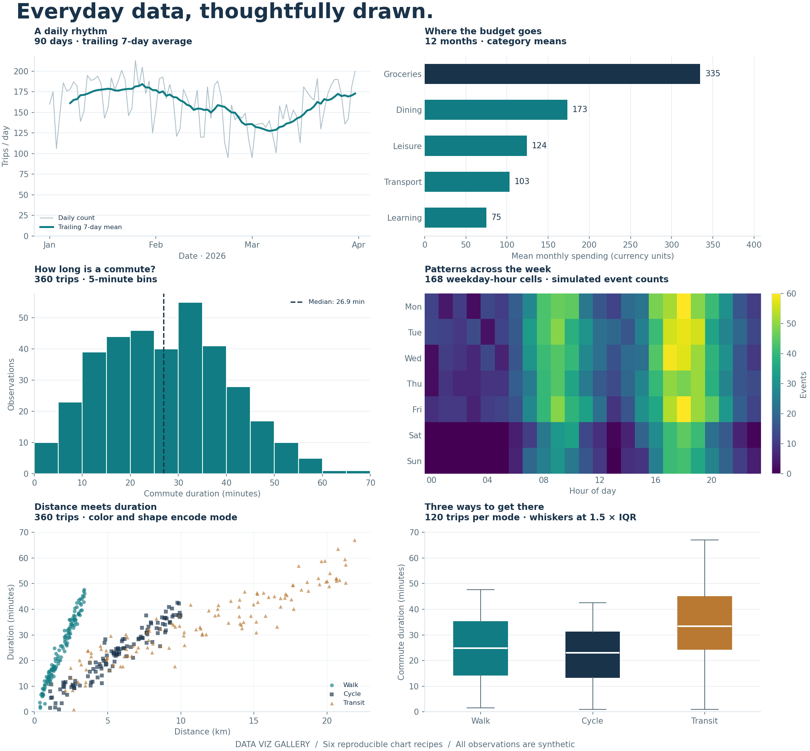

# Data Viz Gallery

**Everyday data, thoughtfully drawn.**

Six small chart recipes in Python: consistent colors, explicit units, and
reproducible data. Each example includes the CSVs, plotting code, and PNG/SVG
exports.

[Browse the live gallery →](https://hayiwei.github.io/data-viz-gallery/)

**All data is synthetic.** These are visual design examples, not findings about
real people, cities, or transport systems.

## The collection

| Recipe | What it shows | Design choice |
| --- | --- | --- |
| [Daily trend](docs/figures/01-daily-trend.svg) | Daily counts and a trailing seven-day mean | Keep raw variation visible behind the smoother |
| [Spending bars](docs/figures/02-spending-bars.svg) | Mean monthly spending across five categories | Sorted horizontal bars, a zero baseline, and direct labels |
| [Duration histogram](docs/figures/03-duration-histogram.svg) | 360 simulated commute durations | Fixed five-minute bins and a labeled median |
| [Activity heatmap](docs/figures/04-activity-heatmap.svg) | Event counts by weekday and hour | Ordered axes and a perceptually ordered color scale |
| [Distance scatter](docs/figures/05-distance-scatter.svg) | Distance and duration across three travel modes | Redundant color and marker shapes |
| [Mode boxplot](docs/figures/06-mode-boxplot.svg) | Duration distributions, 120 observations per mode | Show medians, quartiles, and 1.5-IQR whiskers |

## Browse without installing Python

Open the [live gallery](https://hayiwei.github.io/data-viz-gallery/), or clone
or download the repository and open **docs/index.html** in your browser.
The gallery is a self-contained static page, with local images and no network
dependencies. Each chart links to PNG and editable SVG exports.

## Reproduce every chart

Python 3.11+ is required. The pinned environment is tested on Python 3.13.

~~~bash
git clone https://github.com/Hayiwei/data-viz-gallery.git
cd data-viz-gallery
python -m venv .venv
~~~

Activate with .\.venv\Scripts\Activate.ps1 on Windows PowerShell, or
source .venv/bin/activate on macOS/Linux. Then:

~~~bash
python -m pip install -r requirements.txt
python -m gallery.build
~~~

This reads the checked-in CSVs and writes six PNGs, six SVGs, a contact sheet,
and a static HTML gallery into docs/. No API keys, downloads, or GUI are needed.

To regenerate the underlying examples using NumPy seed 2026:

~~~bash
python -m gallery.build --regenerate-data
~~~

To write the gallery to another directory:

~~~bash
python -m gallery.build --output my-gallery
~~~

## Adapt a recipe

- Change colors and typography in [gallery/style.py](gallery/style.py).
- Edit individual plotting functions in [gallery/charts.py](gallery/charts.py).
- Replace a CSV while retaining its documented columns and units.
- Keep the data description, sample sizes, titles, and labels aligned with your data.

Each recipe accepts an existing Matplotlib Axes, so the same code draws an
individual figure and a panel in the overview.

## Data and interpretation

[Data provenance](data/README.md) documents the generation process and units.
Commute durations are constructed from mode-specific speed assumptions plus
noise, so their relationship with distance is built into the example. Equal
group sizes are a design choice. The spending chart shows means over twelve
synthetic months, not estimates with confidence intervals.

The line chart uses a trailing seven-day rolling mean and leaves its first six
values undefined. Boxplot whiskers extend to the furthest observations within
1.5 × IQR; any displayed outliers are not automatically errors.

## Check the build

~~~bash
python -m pip install -r requirements-dev.txt
python -m pytest -q
~~~

Tests check deterministic data generation, basic data invariants, and a complete
build into a temporary folder, including parseable SVGs.

## Credits

Built with NumPy, pandas, and Matplotlib, with development assistance from
OpenAI Codex. The plotting workflow was informed by Kassis et al. (2026),
[Scientific Agent Skills: A Library of Procedural Knowledge for Research Agents](https://doi.org/10.48550/arXiv.2609.00065).

MIT licensed. See [LICENSE](LICENSE).
